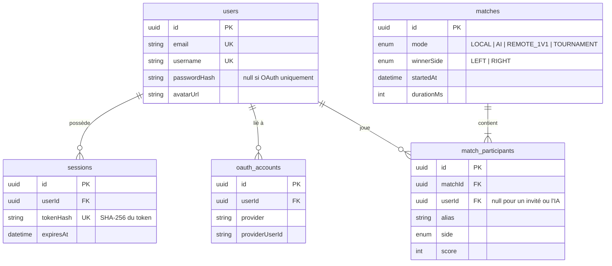

*Ce projet a été réalisé dans le cadre du cursus 42 par treig.*

# ft_transcendence

## Description

**ft_transcendence** est une application web full-stack autour d'un **Pong** au style arcade rétro. Après s'être inscrit (email/mot de passe ou OAuth 42), on peut jouer en local contre un ami, contre une IA, ou en ligne en temps réel contre un autre joueur. Chaque partie terminée est enregistrée dans l'historique du joueur.

**Fonctionnalités principales**
- Authentification sécurisée (Argon2id, sessions en cookie `httpOnly`) et connexion via **42 OAuth**
- Pong en **local**, contre une **IA** (3 niveaux) ou **à distance** via WebSockets, avec gestion des déconnexions
- **Personnalisation** : vitesse de balle, taille des raquettes, score de victoire, 3 thèmes, power-ups
- **Historique des parties** paginé sur le profil
- Interface en **français, anglais et espagnol**
- HTTPS partout via Nginx, déploiement en une commande avec Docker

## Lancer le projet

### Prérequis
- **Docker** et **Docker Compose v2**
- Ports **80** et **443** libres (modifiables dans `.env`)

### Installation

```bash
git clone https://github.com/42-Cursus-treig/ft-transcendence.git
cd ft-transcendence
cp .env.example .env
```

Remplir le `.env` :

| Variable | Rôle |
|---|---|
| `POSTGRES_USER` / `POSTGRES_PASSWORD` / `POSTGRES_DB` | Identifiants de la base |
| `DATABASE_URL` | Doit reprendre les trois valeurs ci-dessus |
| `JWT_SECRET` | Secret aléatoire de 32 caractères minimum (`openssl rand -hex 32`) |
| `OAUTH_42_CLIENT_ID` / `OAUTH_42_CLIENT_SECRET` | Identifiants d'une [application 42](https://profile.intra.42.fr/oauth/applications/new) (nécessaire seulement pour « Se connecter avec 42 ») |
| `OAUTH_42_REDIRECT_URI` | `https://localhost/api/auth/oauth/42/callback`, à déclarer aussi dans l'application 42 |

### Démarrage

```bash
docker compose up --build
```

Ouvrir **https://localhost** et accepter l'avertissement du certificat (il est auto-signé et généré au premier lancement). Les migrations de la base sont appliquées automatiquement.

Pour arrêter : `docker compose down` (ajouter `-v` pour supprimer aussi la base).

### Contrôles

| | Joueur gauche | Joueur droit |
|---|---|---|
| Monter | `W` | `↑` |
| Descendre | `S` | `↓` |

## Stack technique

| Couche | Technologies |
|---|---|
| Frontend | React 18, TypeScript, Vite, React Router, Tailwind CSS, i18next, Zod, Canvas HTML5 |
| Backend | Node.js 22, Fastify 4 (`websocket`, `cookie`, `cors`, `helmet`), Prisma 5, Argon2, Zod |
| Base de données | PostgreSQL 16 |
| Infra | Docker Compose, Nginx (TLS, redirection HTTP → HTTPS, proxy WebSocket), GitHub Actions |

**Choix principaux**
- **TypeScript partout** : le moteur du jeu est partagé entre le front et le back.
- **Fastify** : léger, rapide et bien adapté aux WebSockets pour une boucle de jeu à 60 Hz.
- **PostgreSQL + Prisma** : relations et contraintes fortes, requêtes typées, migrations versionnées.
- **Sessions côté serveur** plutôt que des JWT : la session est révocable immédiatement, et le même cookie authentifie le WebSocket.
- **Serveur autoritaire** en ligne : le serveur calcule la physique, les clients n'envoient que leurs touches. Pas de désynchronisation ni de triche possible.

## Schéma de la base de données



Les sessions et les comptes OAuth sont supprimés avec l'utilisateur. Les parties sont conservées : le participant passe alors à `null`.

## Fonctionnalités

| Fonctionnalité | Description |
|---|---|
| Inscription / connexion | Règles de mot de passe strictes, hash Argon2id, messages d'erreur génériques, sessions de 7 jours |
| OAuth 42 | Flux *authorization code* avec `state` anti-CSRF. Crée le compte ou le lie par email, et récupère l'avatar 42 |
| Validation | Schémas Zod côté front **et** côté back |
| Pong local | Deux joueurs sur un clavier, avec un alias pour l'invité |
| IA | 3 niveaux. Elle ne lit le jeu qu'une fois par seconde, anticipe la trajectoire et commet des erreurs « humaines » |
| Pong en ligne | Lobby, création et rejoint de partie, compte à rebours, partie en temps réel |
| Déconnexions | Pause du jeu, reprise si le joueur revient dans les 15 s, sinon victoire par forfait |
| Personnalisation | Vitesse, taille des raquettes, score 3/5/7, thèmes Classic/Synthwave/Mono, power-ups |
| Historique | Toutes les parties (locales, IA, en ligne) avec score, adversaire, mode, date et durée |
| Langues | FR / EN / ES, détection automatique et sélecteur dans l'en-tête |
| Pages légales | Politique de confidentialité et CGU accessibles depuis le pied de page |

## Modules

| Module | Type | Points |
|---|---|---|
| Framework frontend + backend (React + Fastify) | Majeur | 2 |
| Temps réel avec WebSockets | Majeur | 2 |
| Jeu web complet (Pong) | Majeur | 2 |
| Joueurs à distance | Majeur | 2 |
| Adversaire IA | Majeur | 2 |
| ORM (Prisma) | Mineur | 1 |
| Multilingue (3 langues) | Mineur | 1 |
| OAuth 2.0 (42) | Mineur | 1 |
| Personnalisation du jeu | Mineur | 1 |
| **Total** | | **14** |

## Difficultés rencontrées

- **Synchronisation en ligne** : le serveur fait tourner la seule vraie simulation et les clients ne font qu'afficher l'état reçu. Le pas de temps est plafonné à 50 ms pour qu'un pic de latence ne fasse pas traverser une raquette à la balle.
- **Déconnexions** : la partie passe dans un état `PAUSED` avec un délai de grâce. Un nouveau socket peut se rattacher à la même partie pour la reprendre.
- **Une IA crédible** : elle anticipe la trajectoire (rebonds compris) à partir d'une seule image par seconde. Du bruit, un temps de réaction et des hésitations la rendent battable.
- **Authentifier le WebSocket** : un navigateur ne peut pas ajouter d'en-têtes personnalisés au handshake, donc le serveur vérifie le cookie de session `httpOnly`.

## Ressources

- [React](https://react.dev/) · [Fastify](https://fastify.dev/docs/latest/) · [Prisma](https://www.prisma.io/docs) · [Tailwind CSS](https://tailwindcss.com/docs) · [i18next](https://www.i18next.com/)
- [MDN – WebSocket](https://developer.mozilla.org/fr/docs/Web/API/WebSocket) · [MDN – Canvas](https://developer.mozilla.org/fr/docs/Web/API/Canvas_API)
- [API 42](https://api.intra.42.fr/apidoc) · [RFC 6749 – OAuth 2.0](https://datatracker.ietf.org/doc/html/rfc6749)
- [OWASP – Stockage des mots de passe](https://cheatsheetseries.owasp.org/cheatsheets/Password_Storage_Cheat_Sheet.html)
- [Gabriel Gambetta – Fast-Paced Multiplayer](https://www.gabrielgambetta.com/client-server-game-architecture.html) · [Glenn Fiedler – Fix Your Timestep!](https://gafferongames.com/post/fix_your_timestep/)
